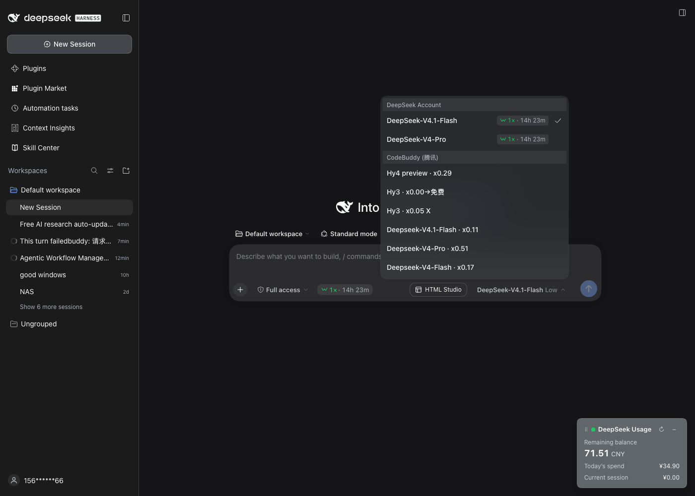
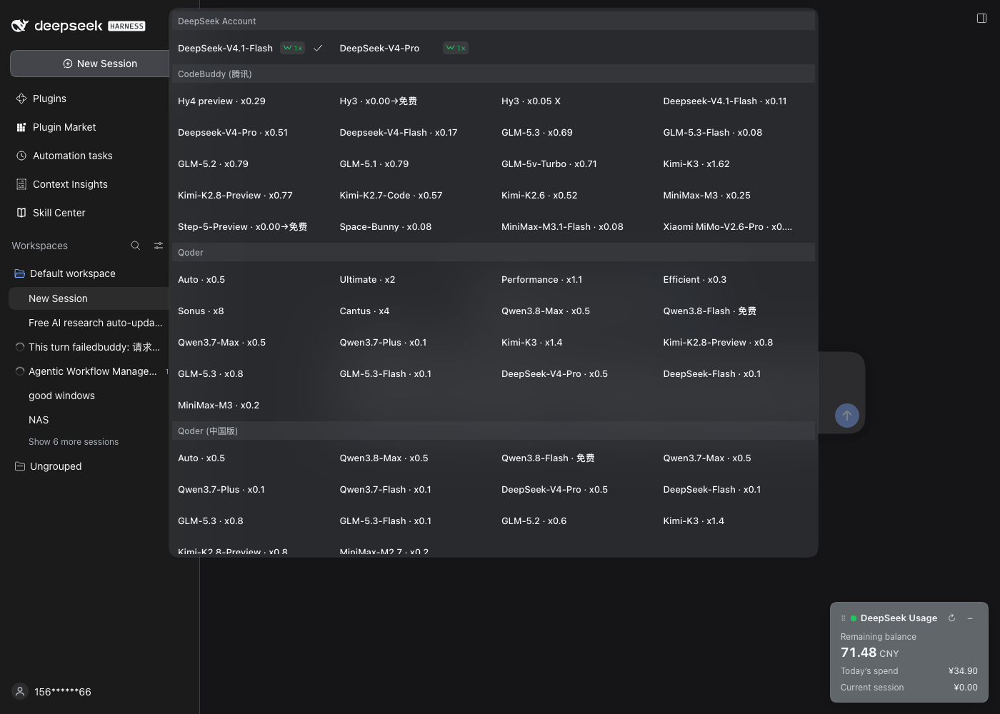

# dsh-model-grid

[](https://github.com/anonamerjaxon-dev/dsh-model-grid/actions/workflows/ci.yml)
[](LICENSE)

Turn the composer model picker in [DeepSeek Harness](https://github.com/deepseek-ai/deepseek-harness) from a long one-per-row list into a responsive **card grid**, grouped by provider.

| Before | After |
| --- | --- |
|  |  |

## Features

- **Responsive grid.** As many columns as fit the popup (`auto-fill`), never fewer than one, so it degrades gracefully on narrow windows.
- **Grouped by provider.** Each provider keeps its own section; the provider heading spans the full row.
- **Works with both pickers.** The stock `dsh-client-ui-model-selection` dropdown *and* the third-party `dsh-peakrate` model menu (which replaces the stock trigger when installed). The stylesheet does not depend on either plugin being present.
- **Configurable.** Width, card width, gap, height cap, and whether to hide the long price countdown.
- **Host-only, upgrade-safe.** A single `<style>` is injected into the page `<head>` through the `webserver/index-inject` event. No client bundle is rebuilt, so it keeps working after DSH updates.
- **No runtime dependencies.**

## Supported pickers

| Picker | What identifies it | Notes |
| --- | --- | --- |
| Stock `dsh-client-ui-model-selection` | `[data-menu-group]` sections, `[role="menuitemradio"]` buttons | Attribute-based selectors, so hashed CSS-module class names don't matter. |
| `dsh-peakrate` model menu | `.dsh-peakrate-ms-menu`, `.dsh-peakrate-ms-group`, `.dsh-peakrate-ms-option` | Optional; this plugin never depends on it. |

The rules are scoped so the two-cell root pane (Model / Reasoning effort) of the peakrate menu keeps its normal narrow width — only the grouped model list is widened.

## Install

This is a DSH **profile plugin**. It is host-only, and the web UI must live at the bundle layer to appear, so it needs to be in `dsh.profile.bundles`.

```sh
# 1. add the dependency to a profile
dsh plugin --profile web add github:anonamerjaxon-dev/dsh-model-grid

# 2. add "dsh-model-grid" to dsh.profile.bundles in
#    ~/.dsh/profiles/web/package.json, then restart the profile
dsh web
```

If you prefer a local checkout:

```sh
dsh plugin --profile web add link:/path/to/dsh-model-grid
```

Then add the same `"dsh-model-grid"` entry to `dsh.profile.bundles` and restart.

> Restarting the profile is required: the host plugin is loaded at boot and the stylesheet is injected when the page is served.

## Configuration

Options are passed through the plugin entry's `config` and merged with the defaults.

| Key | Default | Description |
| --- | --- | --- |
| `maxWidth` | `900` | Hard cap on the popup width, in CSS px (clamped 240–4000). |
| `minCardWidth` | `200` | Minimum width of a model card, in CSS px (clamped 80–1200). |
| `gap` | `6` | Gap between cards, in CSS px (clamped 0–64). |
| `maxHeightVh` | `76` | Popup height cap, in `vh` (clamped 20–100). |
| `hideCountdown` | `true` | Hide the long "· 14h 23m" countdown in the price badge. |
| `enabled` | `true` | When `false`, nothing is injected. |

Example — in the profile's `cordis.patch.yml`:

```yaml
- insert:
    - id: model-grid
      name: 'dsh-model-grid'
      config:
        maxWidth: 1100
        minCardWidth: 180
        hideCountdown: false
```

## How it works

1. `apply(ctx, config)` listens for the host's `webserver/index-inject` event.
2. On every index response, the listener pushes one `{ kind: "style", text }` row.
3. DSH renders that row as a `<style>` block in `<head>`.

Because the CSS is generated from `css.js` at injection time, there is no file I/O and nothing to keep in sync. `buildCss()` is exported and unit-tested independently of the host.

## Compatibility

- DeepSeek Harness **0.2.1-rc.2** (declared in `package.json` → `dsh.compatibility`).
- Node.js **>= 22**.
- No bundler, no client build step.

## Development

```sh
git clone https://github.com/anonamerjaxon-dev/dsh-model-grid.git
cd dsh-model-grid
node --test
```

The test suite covers config defaults/clamping, both picker selector sets, the countdown toggle, and the injection table.

## License

[MIT](LICENSE) © 2026 Jackson Yao
